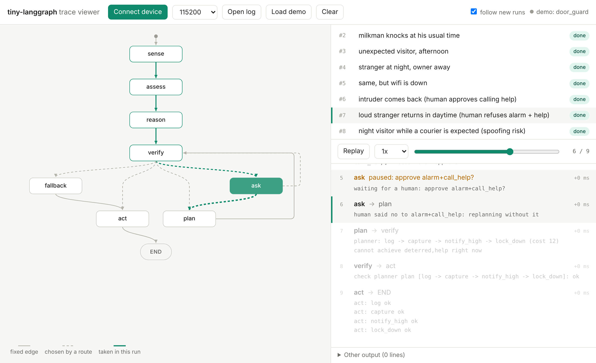

# tiny-langgraph

**LangGraph-style agents for microcontrollers.** Write the agent in Python like a LangGraph
graph; tiny-langgraph turns it into C for an ESP32-S3 or a NodeMCU, where your rules and a
planner decide, a verifier checks every action before it runs, and a web page shows the agent
thinking, live, from the board.



**[Documentation](https://mak-ahoy.github.io/tiny-langgraph/)** · [Get started](https://mak-ahoy.github.io/tiny-langgraph/get-started/installation/) · [Examples](examples)

> **Early (v0.4), research project.** Runs on real ESP32-S3 and NodeMCU boards.
> Inspired by [LangGraph](https://github.com/langchain-ai/langgraph); not affiliated with LangChain.

## Features

- **The LangGraph API you know:** `StateGraph`, `add_node`, `add_conditional_edges`, `compile`,
  `invoke`, `interrupt`, tools. Runs on your PC with simulated hardware.
- **Python to C, checked:** your nodes, tools and rules become plain C11 (no heap in the graph
  runtime). The build stops unless the C decides exactly like your Python in every situation.
- **Safe by construction:** rules say what's wanted, a planner finds the cheapest plan, a
  verifier checks it, and tools you mark as risky wait for a human (web page with PIN, button).
- **Several boards:** ESP32-S3 and NodeMCU (ESP8266), with built-in drivers (LED, buzzer, servo,
  buttons, sensors, camera, clock) and your own C drivers.
- **Multi-agent across boards:** boards advertise what they can do and ask each other over
  ESP-NOW. A call is a request: the receiving board's own rules decide.
- **MCP server on the board:** AI clients (e.g. Claude Code) list and call a board's tools over
  Wi-Fi, still through its rules and verifier.
- **Optional models:** statistics and decision trees that fill state fields, or a tiny
  transformer trained on your rules, all checked C-vs-Python like everything else.

## Quick start

```sh
git clone https://github.com/mak-ahoy/tiny-langgraph
cd tiny-langgraph
pip install -e .                     # numpy, pyyaml (add torch only to train a model)
cd examples/pet_watcher
python agent.py                      # run the agent on your PC
python agent.py check                # convert to C and check it decides like the Python
python agent.py build                # + the Arduino sketch for the ESP32-S3 in build/esp32s3/
```

Open the sketch in the Arduino IDE, set Wi-Fi in `config.h`, upload, and open the address it
prints. A C compiler (gcc/clang) is optional on the PC: without one the C check is skipped.

## An agent

```python
from tiny_langgraph import START, END, Choice, Int, State, StateGraph, Goal, Goals, prebuilt, rules, tool, want
from tiny_langgraph.drivers import Button, Clock, LED

button, clock, led = Button(pin="D3"), Clock(), LED(pin="D4")

class Feeder(State):
    asked        = Choice("no", "yes")
    fed_recently = Choice("no", "yes")
    fed_at       = Int(-1000)                       # memory between runs

goals = Goals(fed=Goal(5, only_if_wanted=True))

def may_feed(s: Feeder) -> bool:                    # a condition: checked on the device too
    return s.fed_recently == "no"

@tool(cost=3, achieves=goals.fed, needs=may_feed)
def dispense(s: Feeder):
    led.blink(3, 200)
    s.fed_at = clock.minutes()

def sense(s: Feeder):                               # a node: plain Python
    s.asked = "yes" if button.pressed() else "no"
    s.fed_recently = "yes" if clock.minutes() - s.fed_at < 180 else "no"

@rules
def assess(s: Feeder):                              # what the agent wants
    if s.asked == "yes":
        want(goals.fed)

graph = StateGraph(Feeder)
graph.add_node("sense", sense)
graph.add_node("assess", assess)
graph.add_node("plan", prebuilt.plan)               # cheapest plan for what's wanted
graph.add_node("verify", prebuilt.verify)           # checked before anything runs
graph.add_node("ask", prebuilt.ask)                 # human approval for risky tools
graph.add_node("act", prebuilt.Act([dispense]))
graph.add_edge(START, "sense")
graph.add_edge("sense", "assess")
graph.add_edge("assess", "plan")
graph.add_edge("plan", "verify")
graph.add_conditional_edges("verify", prebuilt.after_verify, ["act", "ask", "plan"])
graph.add_conditional_edges("ask", prebuilt.after_ask, ["verify", "plan"])
graph.add_edge("act", END)
app = graph.compile(name="feeder")

if __name__ == "__main__":
    app.cli()                                       # python feeder.py check / build nodemcu
```

## Boards that talk to each other

Two boards share a contract; the watcher asks, the feeder decides
([examples/feeding_station](examples/feeding_station)):

```python
feed = Contract("feed", about="Give the cat food", params={"portions": ("one", "two")},
                replies=("done", "refused", "busy"))

# feeder.py: serves it                       # watcher.py: uses it
mailbox = prebuilt.Mailbox(serves=[feed])    feeder  = Peer("feeder")
...                                          mailbox = prebuilt.Mailbox(uses={feeder: [feed]})
mailbox.reply(feed, "done")                  feeder.call(feed, "one")
```

Every board also serves MCP at `http://<board>/mcp`. Connect Claude Code to a board:

```sh
claude mcp add --transport http feeder http://<board-ip>/mcp --header "Authorization: Bearer <MCP_KEY from config.h>"
```

No board? `python examples/feeding_station/serve.py` runs the feeder as an MCP server on your PC,
and `python examples/feeding_station/run.py` plays both agents on a simulated network.

## Results on hardware

| | ESP32-S3 | NodeMCU (ESP8266) |
|---|---|---|
| Plan + verify (rules + planner) | ~40 µs + ~37 µs (pet watcher) | ~120 µs + ~100 µs (feeder) |
| Whole run, incl. Serial logging | ~12 ms | ~12 ms |
| Tiny transformer instead of the planner | ~120 ms, 185 KB flash, same answers | doesn't fit |
| Two boards over ESP-NOW | watcher asks, feeder feeds, then refuses a second meal by its own rule | |
| MCP over Wi-Fi | | 0.3–0.5 s per call |

For decisions that depend only on the current moment, rules + the planner are ~3,000× faster
than the model and right by construction, so planner-only is the default. More numbers and
how they were measured: [docs/guide.md](docs/guide.md#results-so-far).

## Examples

| Example | What it shows |
|---|---|
| [pet_watcher](examples/pet_watcher) | Python agent with camera, buzzer, servo; optional on-chip model (ESP32-S3) |
| [feeding_station](examples/feeding_station) | two boards (ESP32-S3 + NodeMCU) over ESP-NOW, and MCP |
| [porch_light](examples/porch_light) | a NodeMCU agent |
| [door_guard](examples/door_guard) | lower level: `schema.yaml` + a graph written in C, with a model |
| [hello](examples/hello), [plant_care](examples/plant_care) | the C runtime: smallest graph; approval + checkpoint |

## Documentation

- **[The docs site](https://mak-ahoy.github.io/tiny-langgraph/)**: get started, concepts, guides (boards, multi-agent, MCP, models, drivers), reference.
- [docs/guide.md](docs/guide.md): the full guide: the Python you can use, drivers, coming from
  LangGraph, the C side, the trace viewer, the web page, results, limitations, roadmap.
- `python -m unittest discover -s tests -p "test_*.py"` runs the tests; `make check` runs
  everything (Linux/macOS).

## Limitations

- A Python subset on the device: no floats, lists or strings yet; inputs are categorical
  (`Choice` values).
- Hardware tested so far: one ESP32-S3-CAM and one NodeMCU. Board-to-board messages aren't
  encrypted yet (ESP-NOW broadcast with a shared network key), and MCP runs over plain HTTP
  with a bearer key: keep it on your local network.
- Up to 32 goals, 32 tools and 32 conditions per agent.

## License

[MIT](LICENSE)
