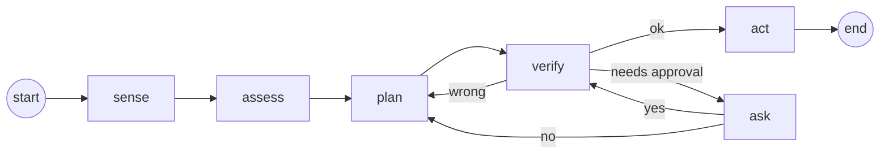

# The graph

The same API as LangGraph's `StateGraph`.

```python
graph = StateGraph(Feeder)
graph.add_node("sense", sense)
graph.add_node("assess", assess)
graph.add_node("plan", prebuilt.plan)
graph.add_node("verify", prebuilt.verify)
graph.add_node("ask", prebuilt.ask)
graph.add_node("act", prebuilt.Act([dispense, refuse]))
graph.add_edge(START, "sense")
graph.add_edge("sense", "assess")
graph.add_edge("assess", "plan")
graph.add_edge("plan", "verify")
graph.add_conditional_edges("verify", prebuilt.after_verify, ["act", "ask", "plan"])
graph.add_conditional_edges("ask", prebuilt.after_ask, ["verify", "plan"])
graph.add_edge("act", END)
app = graph.compile(name="feeder")
```



`app.get_graph().draw_mermaid()` (or `python agent.py mermaid`) prints this diagram for your own graph.

## Nodes

A node is a function taking the state: `def sense(s: Feeder): ...`. It runs on your PC as
Python and on the board as the C the build converts it to, so it uses the
[Python you can use](../reference/python-subset.md).

## Prebuilt nodes

| Node | What it does |
|---|---|
| `@rules` function | decides `Think` fields and calls `want(goals.x)` |
| `prebuilt.plan` | the cheapest plan of tools for what's wanted |
| `prebuilt.reason` | a tiny transformer proposes the plan instead (optional; [Models](../guides/models.md)) |
| `prebuilt.verify` | checks the plan; routes with `prebuilt.after_verify` |
| `prebuilt.ask` | asks a human about risky tools; routes with `prebuilt.after_ask` |
| `prebuilt.Act([tools])` | runs the plan's tools in order. The list order is fixed into a trained model's vocabulary. |
| `prebuilt.Classify({field: question}, model=...)` | a catalog model answers a `Score` field |
| `prebuilt.Mailbox(serves=..., uses=...)` | requests and replies from other boards; put it right after `sense` |

## Routes

`add_conditional_edges(source, route, [targets])` takes every target the route can return. The
graph refuses a route that can return something you didn't list, so a graph can't go somewhere
unexpected on the board. Your own route functions return a node name as a string.

## Running

```python
s = Feeder()
app.invoke(s, verbose=True)            # one run; prints each step
for node, notes in app.stream(s): ...  # step by step
app.invoke(s, trace="run.log")         # a trace for the viewer
app.invoke(s, approve=lambda q: True)  # answer approvals in code
```

A run is one pass from `START` to `END`. On the board, the graph runs every `RUN_EVERY_MS`
(30 s by default). `Int` fields keep their values between runs.

## Pausing for a human

```python
app.invoke(s)
if s.waiting:                    # e.g. "approve dispense?"
    app.resume(s, True)          # or False
```

`interrupt("question")` in your own node pauses the same way. On the board, the question
appears on the web page (PIN), and the BOOT button or `y`/`n` in the Serial Monitor answer it.
No answer within 2 minutes counts as no.

## Limits

One way out of each node (no parallel branches), and at most `max_steps=32` steps per run, so a
loop can't hang the board.
