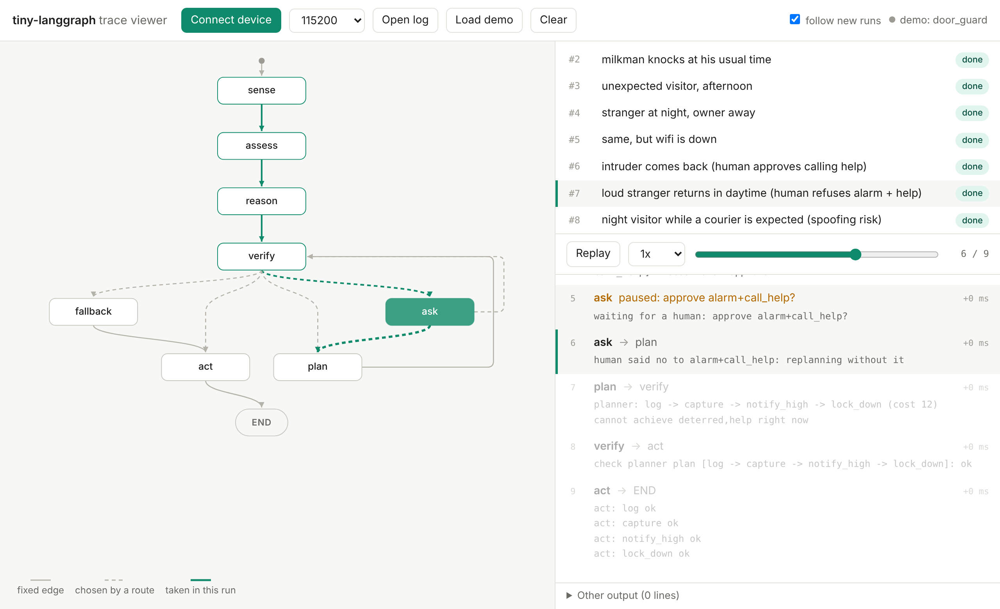
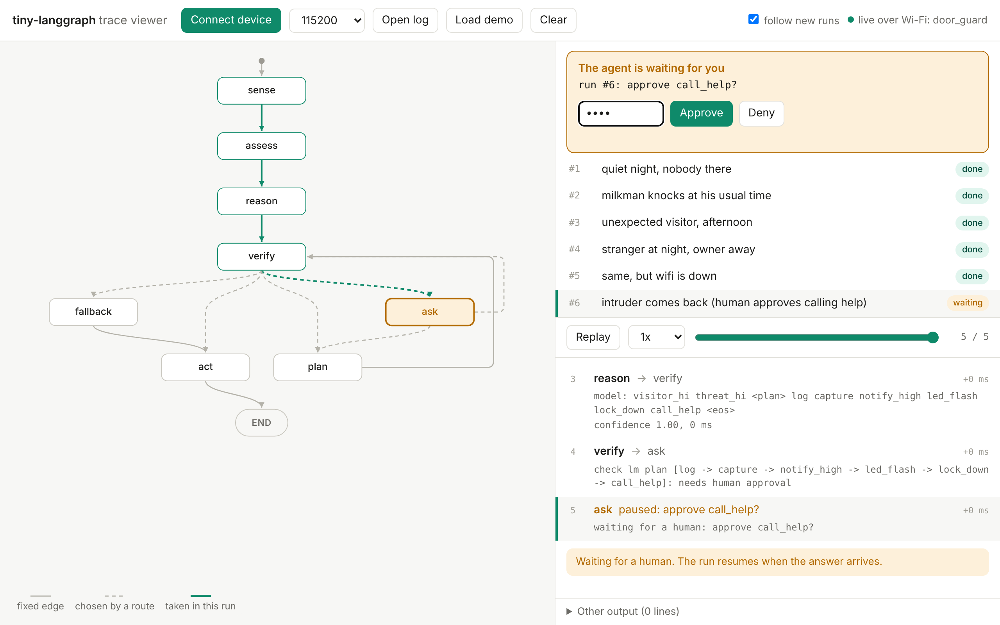

# tiny-langgraph

**LangGraph-style agents for microcontrollers: your rules decide, a verifier checks every
action, and a tiny language model can optionally run on the chip.**

Write your agent in Python, the way you'd write a LangGraph graph. tiny-langgraph turns
it into C for devices like the ESP32-S3, where your rules and a planner decide what to do
and a verifier makes sure nothing unsafe ever runs, offline. If you add a `reason` node, it
also trains a tiny transformer on your rules and runs it inside the graph. A trace viewer
shows the agent thinking, live, from the board's own web page.



> **Status: early (v0.4).** Works end to end on a PC, and the pet watcher runs on a real ESP32-S3-CAM.
> The model is optional: for decisions that depend only on the current moment, rules + the
> planner are faster and just as accurate (see [Results so far](#results-so-far)), so they're the default.
> Inspired by [LangGraph](https://github.com/langchain-ai/langgraph); not affiliated with LangChain.

## Why

A big LLM can't come with you onto a microcontroller. But many devices only need to make
good decisions in one narrow domain: a door camera, a plant monitor, a machine watching for
faults. tiny-langgraph gives them the same structure LangGraph gives LLM apps (a graph of
steps, conditional routing, loops, human approval, checkpoints), and makes every decision
checkable:

- the **planner proposes** the cheapest plan for what your rules want (or, optionally, a
  small **model proposes** one and the planner repairs it if it's wrong),
- the **verifier checks** it against your rules and conditions before anything runs,
- a **human approves** anything you mark as risky.

## Write an agent in Python

If you know LangGraph, you already know most of it. This is the pet watcher
(`examples/pet_watcher/agent.py`, abridged):

```python
from tiny_langgraph import START, END, Choice, Think, Int, State, StateGraph, Goal, Goals, prebuilt, rules, tool, want
from tiny_langgraph.drivers import Buzzer, Clock, DigitalIn, Servo

counter = DigitalIn(pin=2)        # hardware, with your pins
buzzer  = Buzzer(pin=14)
feeder  = Servo(pin=47)
clock   = Clock()

class Pet(State):
    cat          = Choice("none", "seen", "in_zone")   # observed: the model reads it
    meal         = Choice("not_due", "due", "overdue")
    fed_recently = Choice("no", "yes")
    mischief     = Think("no", "yes")                  # concluded: the model predicts it
    fed_at       = Int(-1000)                          # memory, kept between runs

goals = Goals(recorded=1, deterred=Goal(4, only_if_wanted=True), fed=Goal(5, only_if_wanted=True))

def can_feed(s: Pet) -> bool:                       # a condition, checked on the device too
    return s.meal != "not_due" and s.fed_recently == "no"

@tool(cost=3, achieves=goals.fed, needs=can_feed)
def dispense(s: Pet):
    feeder.turn(90)
    s.fed_at = clock.minutes()

def sense(s: Pet):                                  # a node: plain Python
    s.cat = "in_zone" if counter.read() else "none"
    s.fed_recently = "yes" if clock.minutes() - s.fed_at < 180 else "no"

@rules                                              # the model learns these; the device checks it against them
def assess(s: Pet):
    s.mischief = "yes" if s.cat == "in_zone" else "no"
    want(goals.recorded)
    if s.meal != "not_due":
        want(goals.fed)

graph = StateGraph(Pet)
graph.add_node("sense", sense)
graph.add_node("assess", assess)
graph.add_node("plan", prebuilt.plan)               # the planner finds the cheapest plan
graph.add_node("verify", prebuilt.verify)           # checked against your rules and conditions
graph.add_node("ask", prebuilt.ask)                 # human approval for risky tools
graph.add_node("act", prebuilt.Act([log, chirp, dispense]))
graph.add_edge(START, "sense")
graph.add_edge("sense", "assess")
graph.add_edge("assess", "plan")                    # or: assess -> reason -> verify, to add the model
...
graph.add_conditional_edges("verify", prebuilt.after_verify, ["act", "ask", "plan"])
app = graph.compile(name="pet_watcher")

app.invoke(Pet(), verbose=True)                    # runs on your PC, hardware simulated
```

```sh
pip install -e .                  # from this repo (numpy, pyyaml; add torch to train)
cd examples/pet_watcher
python agent.py                   # try it on your PC
python agent.py build             # write C, check it, make the ESP32-S3 sketch
$env:USE_MODEL=1; python agent.py build   # the same with the model (PowerShell; USE_MODEL=1 ... on Linux/macOS)
```

`app.build()` (or `python agent.py build`) does everything between your file and the board:

| Step | What happens |
|---|---|
| convert | your nodes, routes, tools, conditions and rules become C (`generated/`) |
| label | every situation (3,888 here) is labeled by running your `@rules` and the planner |
| train | only with a `reason` node: the model is retrained when the rules or tools changed (~1.5 min on a laptop CPU) |
| check | the C is compiled and must decide exactly like your Python in every situation, or the build stops |
| package | `build/pet_watcher/pet_watcher.ino`: open it in the Arduino IDE, set Wi-Fi in `config.h`, upload |

You never need to read the generated C, but it's plain and readable if you want to.

### The Python you can use

Nodes, tools, conditions and rules use the parts of Python that make sense on a
microcontroller: `if/elif/else`, `for i in range(n)`, comparisons, `and/or/not`,
`+ - * // %`, `x if c else y`, `min/max/abs`, local whole numbers and booleans,
`s.field = ...`, calls to your other functions and to drivers, and lookup tables
(`POINTS[s.cam]` with `POINTS` a dict at the top of the file). Not available: lists,
strings other than Choice values and messages, floats, imports inside functions,
`while` loops (they could hang the board) and recursion. Anything else stops the build
with the file, line and what to use instead:

```
agent.py:131: floats aren't supported yet; use whole numbers (e.g. tenths of a degree)
```

Conditions and `@rules` may only read Choice and Think fields: the build checks the C
against the Python (and trains the model, if any) on every combination of them, so their
answers must not depend on memory or hardware.

### Hardware

Built in: `LED`, `Buzzer`, `Servo`, `DigitalIn`, `Button`, `AnalogIn`, `Camera` (snapshots
served at `/snapshot.jpg`), `Clock` (internet time), `Wifi`, `Phone` (messages on the web
page). On the PC they're simulated: set `motion.value = True` or `clock.set(hour=22)`. The
build stops if two drivers share a pin, or a pin belongs to the camera, flash or PSRAM.

For your own hardware, write the C and give Python a stand-in for the PC:

```python
class Feeder(CDriver):
    c_files = ["feeder.c"]                  # void feeder_dispense(int32_t portions)
    def dispense(self, portions: int) -> None:
        print("feeding", portions)          # what happens on the PC
```

### Coming from LangGraph

| LangGraph | tiny-langgraph |
|---|---|
| `TypedDict` state | `class S(State)` with `Choice`, `Think`, `Int` fields (fixed types: a C struct on the board) |
| `add_node`, `add_edge`, `add_conditional_edges`, `START`, `END` | the same |
| `compile()`, `invoke()`, `stream()` | the same |
| `get_graph().draw_mermaid()` | the same |
| tools + `ToolNode` | `@tool(cost, achieves, needs, approval)` + `prebuilt.Act([...])` |
| the LLM decides | your `@rules` + the planner decide; optionally a tiny model trained on them proposes, and the verifier keeps it safe |
| `interrupt()` + checkpointer | `prebuilt.ask` / `interrupt()`; `state.waiting`, then `app.resume(state, True)` |
| parallel branches | not supported: one way out of each node |

## Try the C side (no hardware needed)

```sh
make demo                 # examples, including the door guard with its on-device model
make trace                # writes build/door_guard.log
```

Open `viewer/index.html` in a browser, then **Open log** and pick `build/door_guard.log`
(or just click **Load demo**). `app.invoke(..., trace="run.log")` writes the same format from Python.

## Lower level: schema.yaml and a C graph

The door guard (`examples/door_guard`) is written the other way: the agent described in
`schema.yaml` (inputs, scores, rules, tools) and the graph written by hand in C. Use it
when you want full control of the firmware.

```yaml
scores:                     # points per observation, added up
  suspicion:
    tod:    { night: 2 }
    expect: { owner: -2, milkman: -2, courier: -2 }
rules:
  think:
    threat:                 # first matching rule wins
      - hi: visitor == hi and suspicion >= 3
      - lo: true
  want:
    informed_high: threat == hi
```

```sh
python tools/tlg.py check examples/door_guard/schema.yaml   # validate
python tools/tlg.py all   examples/door_guard/schema.yaml   # generate C, make data, train
```

```c
static const tlg_node_t NODES[] = {
    [SENSE]  = { "sense",  sense,  TLG_EDGE(ASSESS) },
    [VERIFY] = { "verify", verify, TLG_ROUTE(after_verify, ACT, ASK, PLAN, FALLBACK) },
    ...
};
```

Graphs are static tables: no heap, nothing fails at runtime because memory ran out. Every
route declares where it can go, so `tlg_validate()` catches broken graphs before they run.
A paused run is plain data: save it and resume after a reboot (`examples/plant_care`).

## Trace viewer

Add the tracer to a graph (`.on_step = tlg_trace_on_step`) and every step becomes one line
on the serial port: `@tlg {"k":"step",...}`. Your own prints can share the port.

`viewer/index.html` is one file with no dependencies. It lays out the graph, highlights the
path of each run, shows the agent's notes per step, and replays runs step by step. In Chrome
or Edge, **Connect device** reads a board over USB live.

## On the board, over Wi-Fi

Every sketch the build makes (and `ports/arduino/door_guard_web`) serves the viewer from the
board itself: open `http://pet-watcher.local` on your phone and watch it think.
When the agent wants to do something risky, the page asks you, and the approval needs a PIN.



Open the `.ino` in the Arduino IDE, set your Wi-Fi, PIN and time zone in `config.h`, upload.
Without Wi-Fi the board starts its own network (page at `http://192.168.4.1`). For the door
guard, `python tools/arduino_bundle.py` assembles `build/arduino/door_guard_web`.

- Events reach the page by polling every half second, served from `tlg_hub`, a buffer of
  recent events that also keeps the graph, so a page opened later still has context.
- Approvals also work with the BOOT button or by typing `y`/`n` in the Serial Monitor; no
  answer within 2 minutes counts as no.
- The page is plain HTTP on your local network, read-only without the PIN, with a lockout
  after 5 wrong PINs. No cross-origin access, so other websites can't read the board.
- No board? `make fake-board` serves the same web API on your PC from a recorded trace.

## Results so far

### Model vs planner-only on the chip

The pet watcher on an ESP32-S3-CAM, the same situations run both ways (`USE_MODEL` in
`examples/pet_watcher/agent.py` switches between them):

| | With the model (float32) | Planner only (default) |
|---|---|---|
| Proposing a plan | ~120 ms (119-145 ms) | 40 µs |
| Verifying it | not recorded separately | 36-38 µs |
| Whole run, with Serial logging on | ~132 ms | ~12 ms, of which ~10 ms is printing |
| Flash for the model weights | 184,540 bytes | 0 |
| Whole sketch (camera, web viewer) | 1,269,434 bytes flash, 76,884 bytes globals | 1,080,826 bytes flash, 76,612 bytes globals |
| Correct answers | 388 / 388 held-out situations (it learned to copy `@rules`) | all 3,888 (it *is* `@rules` + the planner) |

For decisions that depend only on the current moment, rules + the planner are about
3,000 times faster than the model, need no model flash, and are right by construction.
That's why planner-only is the default. The model has to earn its place by doing
something the planner can't, such as deciding from the recent history of events; that's
the next research step.

Also measured on the board, with the model: free heap stayed at ~181-188 KB over 28 runs
(no leak), and the escalation worked: it chirped at the cat, then notified the owner once
chirping stopped working.

### Everything else

| | |
|---|---|
| Door guard model | 46,608 parameters, 186 KB (float32) |
| Pet watcher model | 46,128 parameters, 180 KB (float32) |
| Accuracy on held-out situations | door guard 1,843 / 1,843, pet watcher 388 / 388 exact answers |
| Model decision time | 0.4 ms on a PC, ~120 ms on the ESP32-S3 |
| Code size on ESP32-S3 | runtime 1.9 KB, planner + verifier 2.1 KB, tracer 1.3 KB, LM engine 2.6 KB |
| Deepest stack use | 1.4 KB (the planner) |
| C and Python agree | rules + planner on all 18,432 door guard and 3,888 pet watcher situations; the model engine (C vs numpy) on all 3,888 pet watcher situations |

Fault injection (`build/door_guard --corrupt N`) damages N model weights on purpose. Up to
about 20 damaged weights the model still answers correctly; beyond that it writes malformed
output, which the agent discards, and the planner decides instead. No unsafe action ran at
any level tested.

## Repository

```
python/     tiny_langgraph: Python API, Python-to-C converter, build, schema toolchain
core/       graph runtime, planner + verifier, tracer, hub, agent bookkeeping (plain C11)
lm/         transformer inference engine                     (plain C11)
drivers/    built-in drivers: PC (prints) and ESP32-S3 (Arduino)
viewer/     trace viewer                                     (one HTML file)
ports/      arduino: board template with the Wi-Fi viewer; door_guard_web
tools/      tlg.py for schema.yaml agents, Arduino bundling, fake board
examples/   pet_watcher (Python agent + model), door_guard (schema.yaml + C graph + model),
            hello, plant_care (approval + checkpoint)
tests/      C unit tests, toolchain and Python API tests, C-vs-Python cross-checks
```

`make check` runs everything; CI runs it with gcc and clang, under sanitizers, and checks
that the generated code and the committed model are up to date.

## Limitations

- The model learns from rules you write, so today it can only be as good as your rules,
  and it's slower than running them: for decisions that depend only on the current moment
  it adds nothing over rules + the planner (see [Results so far](#results-so-far)). It's optional
  for that reason; making it useful (learning from history) is research in progress.
- Python on the device is a subset (no floats, lists or strings yet), and the inputs the
  model reads are categorical: turn measurements into Choice values in a node.
  Learning from a large LLM as the teacher is the next big step.
- float32 only for now; int8 with ESP32-S3 SIMD is planned (the earlier, 4x larger model
  took about 0.5 s per decision on the chip, limited by memory bandwidth).
- Up to 8 outcomes, 32 actions and 32 facts per schema; inputs are categorical.
- The door guard's rules lower the threat when a visitor is expected, so an intruder
  arriving at delivery time looks less suspicious (demo scenario 8). It's a design
  weakness worth fixing in your own rules, kept visible on purpose.

## Roadmap

- [x] Graph runtime: edges, routes, cycles, interrupts, checkpoints, validation, Mermaid
- [x] Planner + verifier generated from a schema
- [x] Schema toolchain: generate, label, train, export
- [x] Trace viewer: replay and live over USB
- [x] ESP32-S3 port with a web viewer served by the board, and approvals from the page (Arduino)
- [x] Python API like LangGraph; converted to C and checked against the Python automatically
- [x] Built-in drivers (LED, buzzer, servo, inputs, camera, clock) and your own C drivers
- [ ] ESP-IDF port; MQTT for remote access
- [ ] int8 model + ESP32-S3 SIMD
- [ ] Learning loop: log uncertain cases on the device, label them with a large LLM, retrain
- [x] Model optional; planner-only by default
- [ ] Benchmarks on hardware: latency and memory done for the pet watcher; energy per decision to do
- [ ] A model that decides from the recent history of events (design in progress)
- [ ] Verifier fuzzing

## License

MIT
