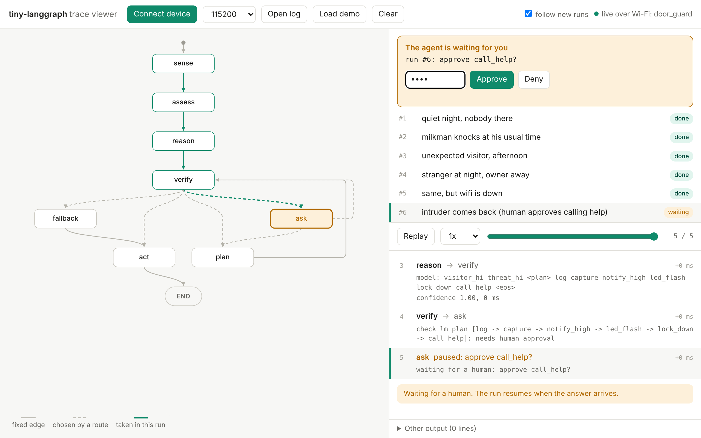

# Web page and trace viewer

## On the board

Every sketch serves a live view of the agent from the board itself. Open
`http://<hostname>.local`, or the IP printed at boot, on any phone or PC on the same network.

- the graph, with each run's path highlighted
- the agent's notes for each step: inputs, what's wanted, the plan, the verifier's verdict, what ran
- approvals: Yes / No with the PIN
- the data log: download it as CSV, or clear it (PIN)
- `/snapshot.jpg`: the last camera picture, if the agent has a camera

The page is read-only without the PIN, and it's plain HTTP on your local network. Other
websites can't read the board.

| Endpoint | |
|---|---|
| `GET /tlg/events?since=N` | trace lines |
| `GET /tlg/pending`, `POST /tlg/answer` | approvals |
| `GET /tlg/log.csv` | the data log (`?day=2026-11-09` for one day) |
| `POST /mcp` | the [MCP server](mcp.md) |

## The trace viewer on your PC

`viewer/index.html` is one file with no dependencies. Open it in a browser, then:

- **Open log**: a trace written by `app.invoke(s, trace="run.log")` or by the C examples
- **Connect device** (Chrome/Edge): read a board live over USB, with `SERIAL_TRACE 1` in `config.h`
- **Load demo**: a recorded door guard run

Trace lines look like `@tlg {"k":"step",...}` and can share the serial port with your own
prints.

## The data log

Once the board's clock is synced, every run appends one line to a file per day: time, every
`Choice`/`Score` field, and the plan. The last `LOG_DAYS` days are kept. Download the log from
the page to fit [models](models.md) on your PC.
