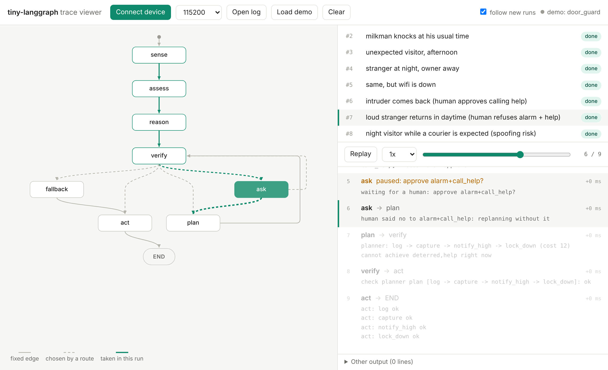

---
hide:
  - navigation
---

# tiny-langgraph

**LangGraph-style AI agents for microcontrollers.** Write the agent in Python like a LangGraph
graph. tiny-langgraph turns it into C for an ESP32-S3 or a NodeMCU, where your rules and a
planner decide, a verifier checks every action before it runs, and a web page served by the
board shows the agent thinking, live.

[Get started](get-started/installation.md){ .md-button .md-button--primary }
[View on GitHub](https://github.com/mak-ahoy/tiny-langgraph){ .md-button }



!!! info "Early (v0.4), research project"
    Runs on real ESP32-S3 and NodeMCU boards. Inspired by
    [LangGraph](https://github.com/langchain-ai/langgraph); not affiliated with LangChain.

## Why

A big LLM can't come with you onto a $3 chip. But many devices only need to make good decisions
in one narrow domain: a pet feeder, a door camera, a plant monitor. tiny-langgraph gives them the
structure LangGraph gives LLM apps (a graph of steps, routing, loops, human approval) and makes
every decision checkable:

- **your rules** say what's wanted,
- **the planner** finds the cheapest plan of tool calls,
- **the verifier** checks it before anything runs,
- **a human** approves anything you mark as risky.

## Thirty seconds of code

```python
class Feeder(State):
    asked        = Choice("no", "yes")
    fed_recently = Choice("no", "yes")

goals = Goals(fed=Goal(5, only_if_wanted=True))

def may_feed(s: Feeder) -> bool:                    # checked on the device too
    return s.fed_recently == "no"

@tool(cost=3, achieves=goals.fed, needs=may_feed)
def dispense(s: Feeder):
    led.blink(3, 200)

@rules
def assess(s: Feeder):
    if s.asked == "yes":
        want(goals.fed)
```

```sh
python feeder.py                 # run it on your PC, hardware simulated
python feeder.py build nodemcu   # C code, checked against the Python, plus an Arduino sketch
```

The full agent is in [Your first agent](get-started/first-agent.md).

## What's in the box

<div class="grid cards" markdown>

-   :material-language-python: **The LangGraph API you know**

    `StateGraph`, `add_node`, `add_conditional_edges`, `compile`, `invoke`, `interrupt`, tools.

-   :material-check-decagram: **Python to C, checked**

    Plain C11 with no heap in the graph runtime. The build stops unless the C decides exactly
    like your Python in every situation.

-   :material-shield-check: **Safe by construction**

    Rules, planner, verifier, and human approval with a PIN or a button.

-   :material-chip: **Several boards**

    ESP32-S3 and NodeMCU (ESP8266), built-in drivers, and your own C drivers.

-   :material-access-point-network: **Boards that talk**

    Boards advertise what they can do and ask each other over ESP-NOW. The receiver's own rules
    decide.

-   :material-robot: **MCP on the board**

    AI clients such as Claude Code list and call a board's tools over Wi-Fi, still through its
    rules.

</div>

## Measured on hardware

| | ESP32-S3 | NodeMCU (ESP8266) |
|---|---|---|
| Plan + verify | ~40 µs + ~37 µs | ~120 µs + ~100 µs |
| A tiny transformer instead of the planner | ~120 ms, 185 KB flash, same answers | doesn't fit |
| Two boards over ESP-NOW | watcher asks, feeder decides | |
| MCP call over Wi-Fi | | 0.3–0.5 s |

More in [Results and limitations](reference/results.md).
